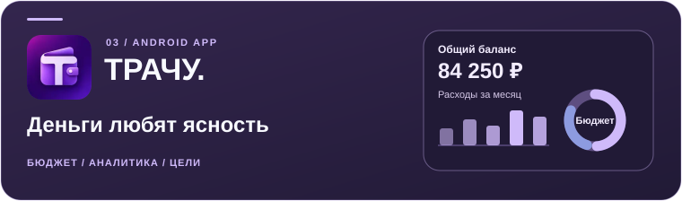

**Независимая разработка приложений для повседневной жизни.**

Independent software for everyday life.

[Наши приложения](#наши-приложения) · [Поддержка](mailto:helpmoorkis@yandex.ru)

## Наши приложения

Городской путеводитель: интересные места, собственные маршруты и автономная версия.

[Открыть сайт](https://epbloger.github.io/shodi/) · [Релизы](https://github.com/epbloger/shodi/releases) · [Репозиторий](https://github.com/epbloger/shodi)

Android-приложение для учёта покупок, сроков получения, возвратов и расходов.

[Скачать в RuStore](https://www.rustore.ru/catalog/app/ru.epbloger.zaberi) · [Сайт](https://epbloger.github.io/zaberi/) · [Репозиторий](https://github.com/epbloger/zaberi)

Нативный финансовый менеджер для Android: доходы, расходы, счета, бюджеты и цели. В разработке.

[Репозиторий](https://github.com/epbloger/trachu) · [Статус сборок](https://github.com/epbloger/trachu/actions)

## О студии

Moorkis Development создаёт приложения для прогулок, покупок и личных финансов. Мы уделяем внимание удобному интерфейсу, доступности основных функций без регистрации и локальному хранению пользовательских записей.

## Связаться с нами

[Поддержка](mailto:helpmoorkis@yandex.ru) · [Разработчик](https://github.com/epbloger)

---

**Moorkis Development** · © 2026

